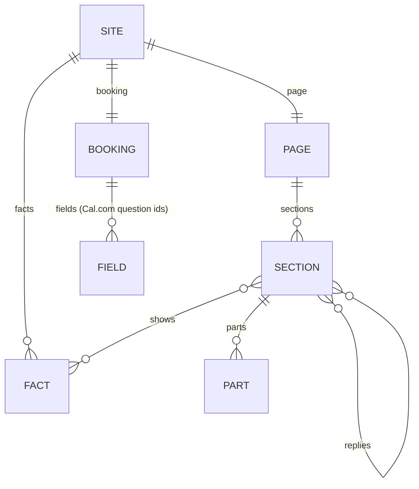

# Data

> Generated by `npm run model` from the code. Don't edit by hand.

## site.json

| Key | Holds |
|---|---|
| `booking` | calLink, origin, embedScript, timeoutSeconds, fields |
| `brand` | string |
| `conversation` | start, you, ask, all, answers, fallback, describe, describeUnset, disclosure |
| `facts` | what, who, firstStep, cost, timeline, reply, location, clients, handover |
| `language` | maxSentenceWords, minSentenceWords, maxGrade, knownAcronyms, banned, bannedBusiness |
| `meta` | title, description |
| `page` | bookLink, sections |
| `person` | name, fullName, email, location, links |
| `reading` | motion, text |
| `timeZone` | string |

## Page parts (`src/parts.js`; * = required)

| Part | Props | Used in |
|---|---|---|
| `headline` | eyebrow: string; lines*: list of string; accent: string | `#problem` |
| `text` | text*: string; style: "intro" | "lead" | "body" | "voice" | "cue" | "small" | `#problem`, `#cases`, `#start`, `#who`, `#intake`, `#book` |
| `cases` | labels*: object; items*: list of objects | `#cases` |
| `list` | head: string; items*: list of objects | `#cases` |
| `steps` | items*: list of objects | `#start` |
| `facts` | items*: list of objects | `#start` |
| `intake` | fields*: list of objects; submit*: string; note: string | `#intake` |
| `booking` | show*: string; loading*: string; failed*: string; open*: string | `#book` |

## Intake fields (the `intake` part)

| Name (Cal.com identifier) | Label | Kind |
|---|---|---|
| `job` | The job that takes up your team's time | long text |
| `scale` | How many people do it, and how often | short text |

## Blocks (`src/catalog.js`; * = required). The page uses parts, not blocks; the library and the fixtures use blocks.

| Category | Block | Props | Fixtures using it |
|---|---|---|---|
| Text | `callout` | text*: string; attribution: string | 1 |
| Text | `code` | content*: string; language: string | 1 |
| Text | `hero` | title*: string; accentWord: string; subtitle: string | 1 |
| Text | `text` | content*: string | 4 |
| Numbers | `metric` | value*: any; label*: string; sublabel: string | 1 |
| Numbers | `metricRow` | items*: list of objects | 1 |
| Numbers | `progress` | label*: string; current*: number; total*: number; sublabel: string | 1 |
| Numbers | `stats` | items*: list of objects | 1 |
| Lists and structure | `badge` | status*: string; variant: "default" | "active" | 1 |
| Lists and structure | `grid` | items*: list of objects | 1 |
| Lists and structure | `layers` | items*: list of objects | 1 |
| Lists and structure | `pills` | items*: list of string; label: string | 1 |
| Lists and structure | `section` | title*: string; kicker: string; tone: "plain" | "raised" | "accent"; blocks*: blocks | 1 |
| Lists and structure | `split` | left: blocks; right: blocks | 1 |
| Lists and structure | `table` | headers*: list of string; rows*: list of list of string | 1 |
| Lists and structure | `timeline` | items*: list of objects | 1 |
| Diagrams | `flow` | layout: "horizontal" | "vertical" | "fanout"; title: string; nodes*: list of objects; edges*: list of objects; loop: object | 1 |
| Interactive | `compare` | label: string; start: number; states*: list of objects | 1 |
| Interactive | `estimate` | title: string; inputs*: list of objects; labels: object; weeksPerYear: number; hoursPerWeek: number; maxCells: number; cellsPerRow: number; note: string; summary: string; addLabel: string; added: string | 1 |
| Facts | `fact` | key*: string; label: boolean | 1 |
| Facts | `facts` | keys: list of string | 1 |
