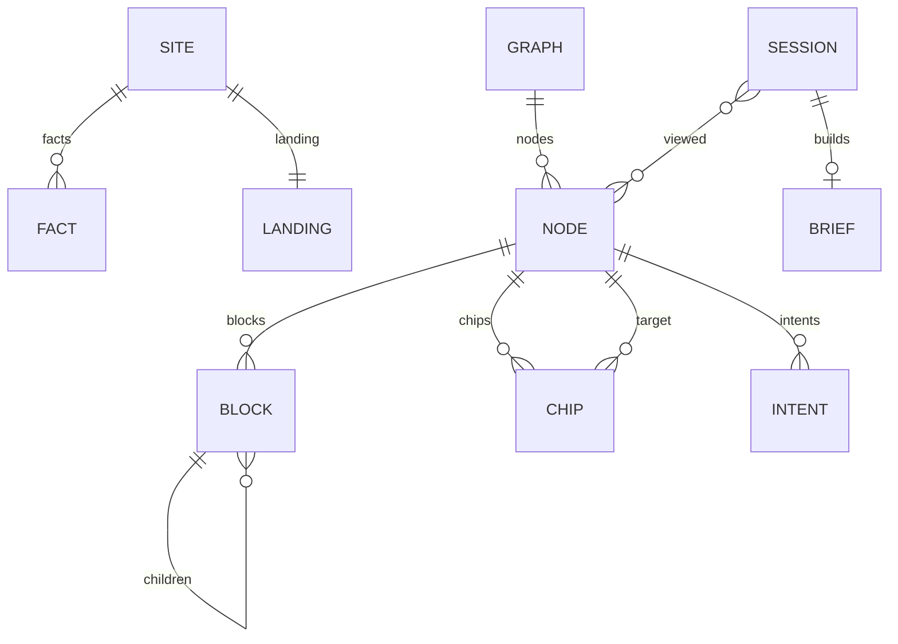

# Data

> Generated by `npm run model` from the code. Don't edit by hand.

## site.json

| Key | Holds |
|---|---|
| `brand` | string |
| `copy` | ui |
| `facts` | what, who, firstStep, cost, timeline, reply, location, clients, handover |
| `features` | map, depthMeter, freeText, sound |
| `landing` | eyebrow, headline, accent, facts, allLink, tool, lens, cue, path |
| `language` | maxSentenceWords, minSentenceWords, maxGrade, knownAcronyms, banned, bannedBusiness |
| `meta` | title, description |
| `onePage` | title, intro, sections, appendix |
| `person` | name, fullName, email, location, links |
| `reading` | motion, text, sound |
| `timeZone` | string |

## Topic fields (24 topics)

| Field | Topics that have it |
|---|---|
| `audience` | 4 |
| `blocks` | 24 |
| `chips` | 24 |
| `id` | 24 |
| `intents` | 24 |
| `label` | 24 |
| `parent` | 24 |
| `tags` | 24 |

## Blocks (`src/catalog.js`; * = required)

| Category | Block | Props | Topics using it |
|---|---|---|---|
| Text | `callout` | text*: string; attribution: string | 6 |
| Text | `code` | content*: string; language: string | 1 |
| Text | `hero` | title*: string; accentWord: string; subtitle: string | 1 |
| Text | `text` | content*: string | 21 |
| Numbers | `metric` | value*: any; label*: string; sublabel: string | 0 |
| Numbers | `metricRow` | items*: list of objects | 1 |
| Numbers | `progress` | label*: string; current*: number; total*: number; sublabel: string | 0 |
| Numbers | `stats` | items*: list of objects | 2 |
| Lists and structure | `badge` | status*: string; variant: "default" | "active" | 1 |
| Lists and structure | `grid` | items*: list of objects | 2 |
| Lists and structure | `layers` | items*: list of objects | 1 |
| Lists and structure | `pills` | items*: list of string; label: string | 5 |
| Lists and structure | `section` | title*: string; kicker: string; tone: "plain" | "raised" | "accent"; blocks*: blocks | 0 |
| Lists and structure | `split` | left: blocks; right: blocks | 2 |
| Lists and structure | `table` | headers*: list of string; rows*: list of list of string | 0 |
| Lists and structure | `timeline` | items*: list of objects | 0 |
| Diagrams | `flow` | layout: "horizontal" | "vertical" | "fanout"; title: string; nodes*: list of objects; edges*: list of objects; loop: object | 5 |
| Interactive | `compare` | label: string; start: number; states*: list of objects | 1 |
| Interactive | `estimate` | title: string; inputs*: list of objects; labels: object; weeksPerYear: number; hoursPerWeek: number; maxCells: number; cellsPerRow: number; note: string; summary: string; addLabel: string; added: string | 1 |
| Facts | `fact` | key*: string; label: boolean | 3 |
| Facts | `facts` | keys: list of string | 2 |
| Session | `brief` | data*: object | 0 |
| Session | `compose` | data*: object | 0 |
