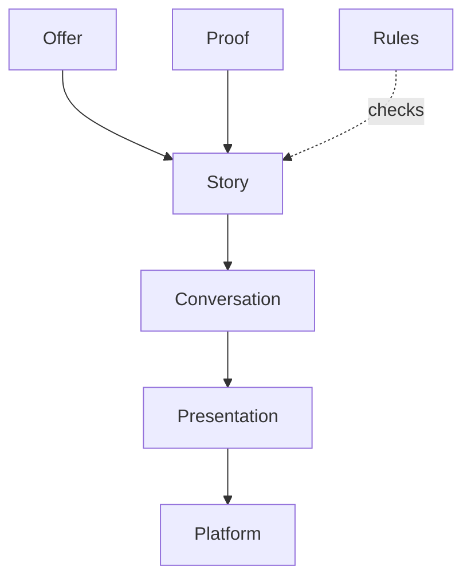

# Domains

> Generated by `npm run model` from the code. Don't edit by hand.
> Which domain each part belongs to is set in `scripts/model.mjs` (SITE_DOMAINS, FILE_DOMAINS).

## site.json

| Part | Domain | Words |
|---|---|---|
| `site.json › $comment` | - | 38 |
| `site.json › brand` | Platform | 1 |
| `site.json › copy` | Presentation | 25 |
| `site.json › facts` | Offer | 84 |
| `site.json › features` | Platform | 0 |
| `site.json › landing` | Story | 486 |
| `site.json › language` | Rules | 125 |
| `site.json › meta` | Platform | 30 |
| `site.json › onePage` | Story | 22 |
| `site.json › person` | Offer | 4 |
| `site.json › reading` | Platform | 2 |
| `site.json › timeZone` | Platform | 1 |

## Topics

| Domain | Topics | Words |
|---|---|---|
| Offer | 13 | 728 |
| Proof (technical) | 4 | 241 |
| Proof | 6 | 321 |
| Story | 1 | 15 |
