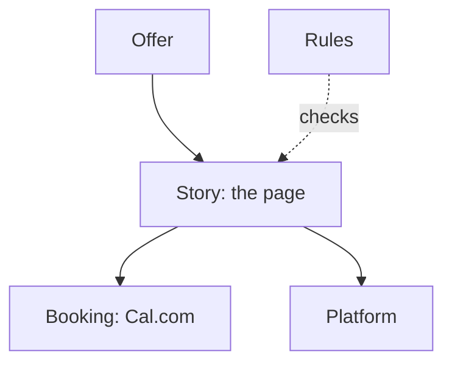

# Domains

> Generated by `npm run model` from the code. Don't edit by hand.
> Which domain each part belongs to is set in `scripts/model.mjs` (SITE_DOMAINS).

## site.json

| Part | Domain | Words |
|---|---|---|
| `site.json › $comment` | - | 46 |
| `site.json › booking` | Booking | 5 |
| `site.json › brand` | Platform | 1 |
| `site.json › facts` | Offer | 105 |
| `site.json › language` | Rules | 125 |
| `site.json › meta` | Platform | 35 |
| `site.json › page` | Story | 980 |
| `site.json › person` | Offer | 5 |
| `site.json › reading` | Platform | 2 |
| `site.json › timeZone` | Platform | 1 |
