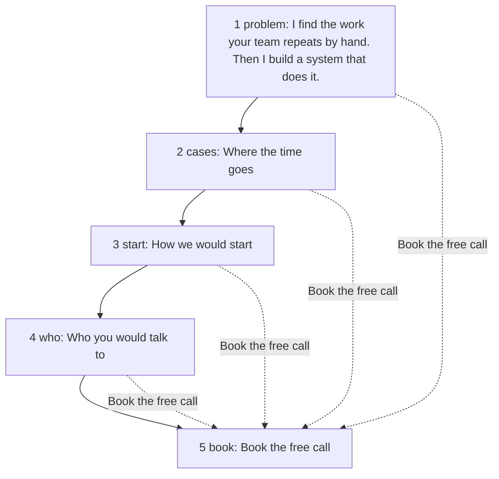

# Process: one visit

> Generated by `npm run model` from the code. Don't edit by hand.
> Read from the page that `npm run sync` writes into index.html.

## The page, top to bottom

| # | Section | Heading | Job | Words | Links to #book | Form |
|---|---|---|---|---|---|---|
| 1 | `#problem` | I find the work your team repeats by hand. Then I build a system that does it. | Say what I do | 38 | yes | no |
| 2 | `#cases` | Where the time goes | Recognition: "that is us" | 325 | yes | no |
| 3 | `#start` | How we would start | Lower the risk | 160 | yes | no |
| 4 | `#who` | Who you would talk to | Trust | 69 | yes | no |
| 5 | `#book` | Book the free call | Pick a time | 25 | no | no |

## Without JavaScript

- No booking link is set (`site.json › booking.calLink` is null): the page shows no form and offers email only.
