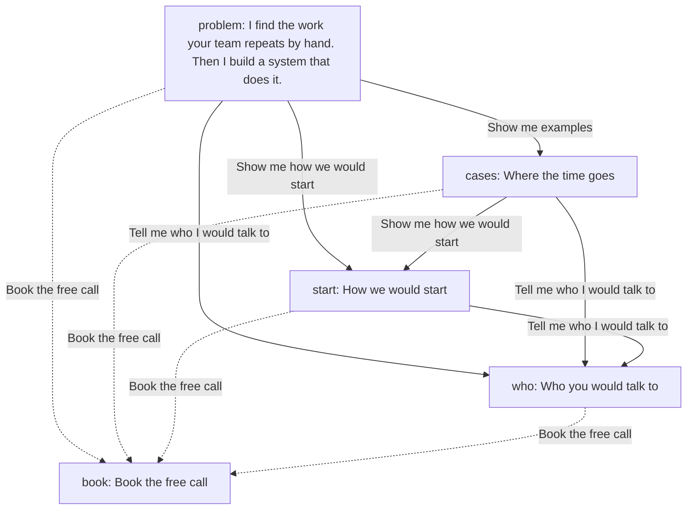
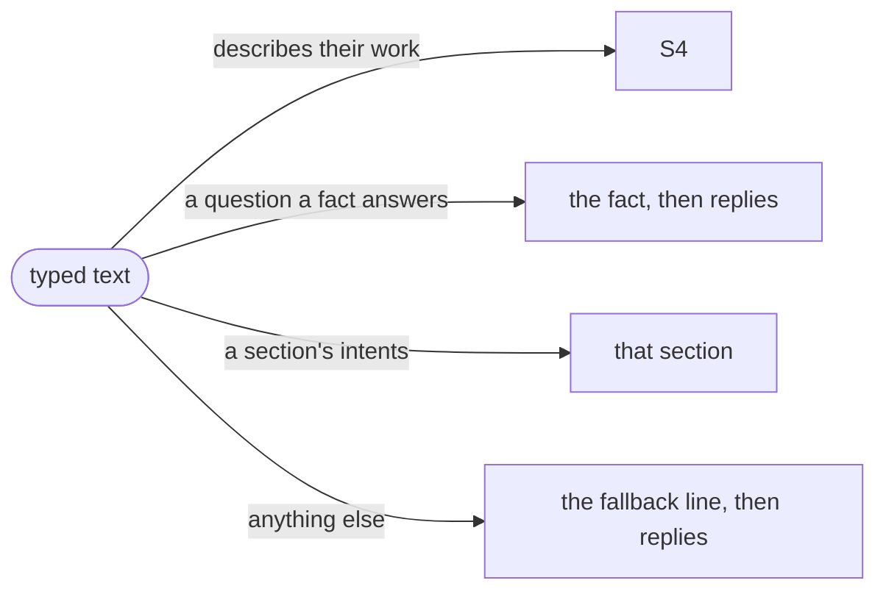

# Process: one visit

> Generated by `npm run model` from the code. Don't edit by hand.
> Read from site.json › page and conversation, and the page `npm run sync` writes.

## The conversation

The page opens on `#problem`. Each reply opens a section under the turn before; only the latest turn offers replies, and never to a section already open. "Show the whole page" (or `/#all`) shows every section in order, as without JavaScript.

## Typed text (`src/route.js`), in this order

| Section | Variant | Heading | Job | Opened by | Parts | Words | Form |
|---|---|---|---|---|---|---|---|
| `#problem` | hero | I find the work your team repeats by hand. Then I build a system that does it. | Say what I do | the start | headline, text | 34 | no |
| `#cases` | plain | Where the time goes | Recognition: "that is us" | "Show me examples" | text, cases, list | 321 | no |
| `#start` | plain | How we would start | Lower the risk | "Show me how we would start" | steps, text, facts | 156 | no |
| `#who` | plain | Who you would talk to | Trust | "Tell me who I would talk to" | text, text, text, text | 65 | no |
| `#book` | booking | Book the free call | Pick a time | "Book the free call" | text | 25 | no |

## Answers to typed questions

| Words | Answer |
|---|---|
| cost, price, pricing, how much, … | fact `cost` |
| how long, timeline, timescale, weeks, … | fact `timeline` (empty: the fallback) |
| where are you, based, location, office, … | fact `location` |
| reply, respond, response, get back | fact `reply` |
| clients, client work, case study, case studies, … | fact `clients` |
| after the project, support, maintain, maintenance, … | fact `handover` (empty: the fallback) |
| what do you do, what is this, what is automation | fact `what` |

## Without JavaScript

- Every section shows, in order. Replies are links to the sections; the ask bar is hidden.
- No booking link is set (`site.json › booking.calLink` is null): the page shows no form and offers email only.
