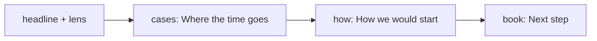
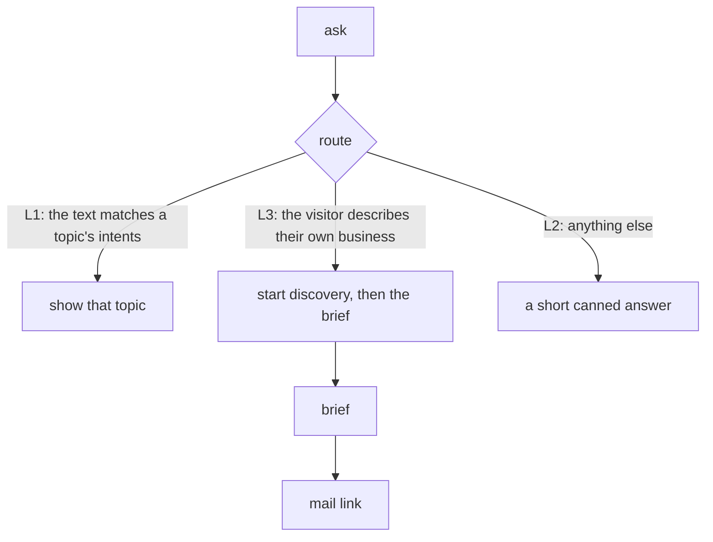

# Process: one visit

> Generated by `npm run model` from the code. Don't edit by hand.

## Landing path, in order (`site.json › landing.path`)

## A typed question (`route` in src/engine.js)

## Special chip targets (`src/app.js`)

| Target | Does |
|---|---|
| `_add_context` | Mark the visitor as describing their business; focus the ask bar. |
| `_book` | Show the brief and a mail link to send it. |
| `_engage` | Ask about the visitor's business (L3 discovery). |
| `_show_brief` | Show the brief built from the visit. |
