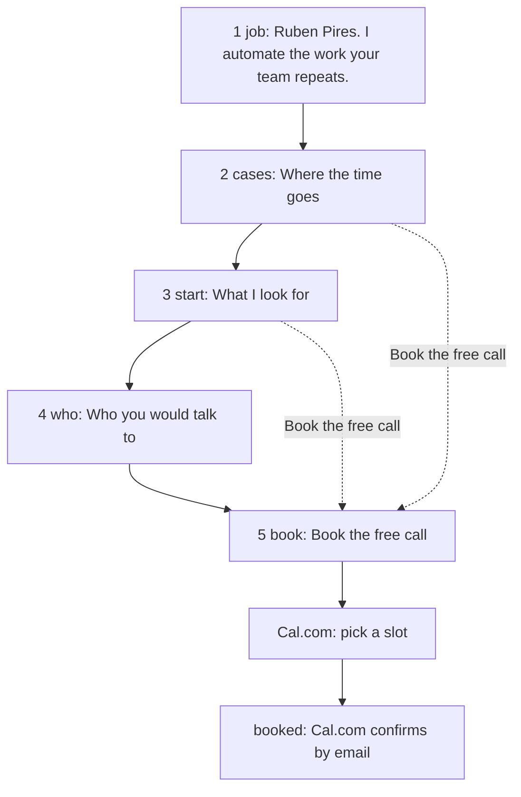

# Process: one visit

> Generated by `npm run model` from the code. Don't edit by hand.
> Read from the page that `npm run sync` writes into index.html.

## The page, top to bottom

| # | Section | Heading | Job | Words | Links to #book | Form |
|---|---|---|---|---|---|---|
| 1 | `#job` | Ruben Pires. I automate the work your team repeats. |  | 147 | no | no |
| 2 | `#cases` | Where the time goes | Recognition: "that is us" | 309 | yes | no |
| 3 | `#start` | What I look for | Lower the risk | 213 | yes | no |
| 4 | `#who` | Who you would talk to | Trust | 60 | no | no |
| 5 | `#book` | Book the free call | Pick a time | 61 | no | no |

## Without JavaScript

- The intake form is a plain `GET` form to `https://cal.com/rwb3n/30min`, with fields `job`, `scale`: the answers prefill the Cal.com page.
- "Show available times" is a plain link to the same page.
