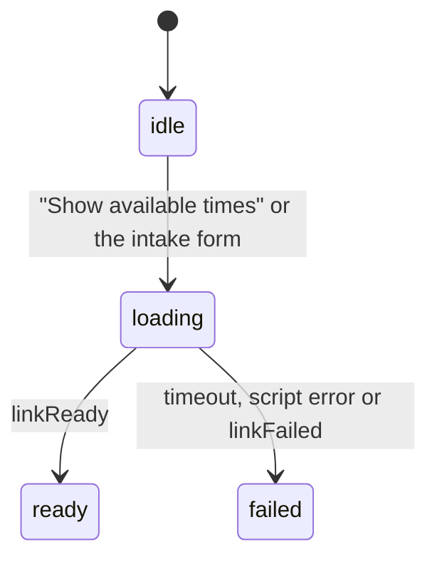

# State: the booking step (`src/book.js`)

> Generated by `npm run model` from the code. Don't edit by hand.

| State | What the visitor sees |
|---|---|
| `idle` | The "Show available times" button. No Cal.com script on the page. |
| `loading` | Cal.com script requested; the loading line shows; the calendar's space is kept. |
| `ready` | Cal.com reported `linkReady`: the calendar is in the page. |
| `failed` | No `linkReady` within the timeout, the script failed, or Cal.com reported `linkFailed`: a link to the Cal.com page, with the answers. |

Timeout: 10 seconds. Booking link: `rwb3n/30min`.

Reading settings (`src/prefs.js`, stored in `localStorage`): motion `full` | `calm` | `off`, text `standard` | `large`.
