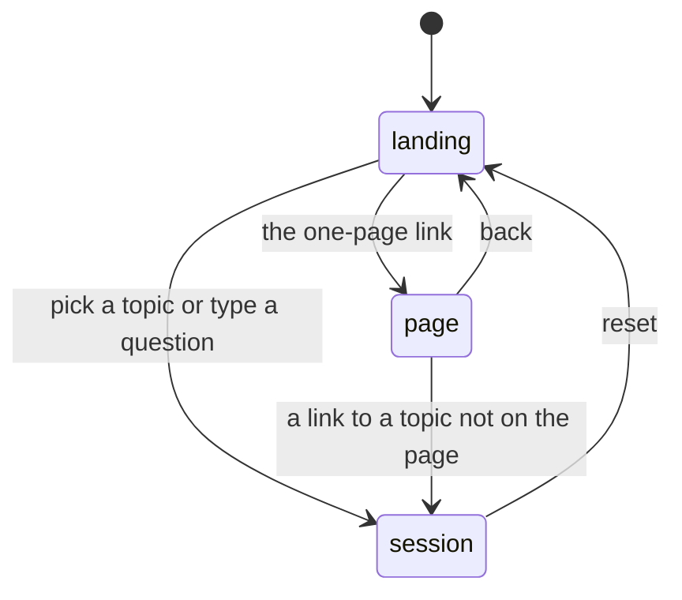
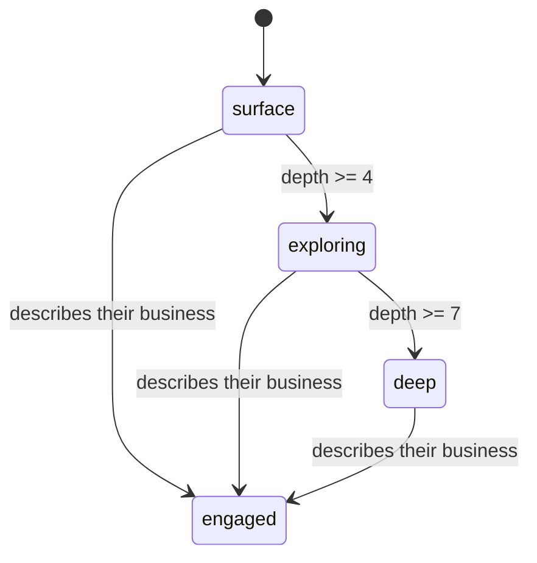

# State

> Generated by `npm run model` from the code. Don't edit by hand.

## Modes (`src/app.js`)

| Mode | What the visitor sees |
|---|---|
| `landing` | The scroll story: headline, lens, the landing path. Start and reset. |
| `session` | The conversation: turns, chips, the ask bar, the side rail. |
| `page` | Everything on one printable page (`/#/all`). No conversation. |

## Session (`newSession()` in src/engine.js)

| Field | Starts as |
|---|---|
| `viewed` | `[]` |
| `interests` | `[]` |
| `freeQuestions` | `[]` |
| `depth` | `0` |
| `selfDisclosed` | `false` |
| `disclosureContent` | `[]` |
| `estimate` | `null` |

## Gravity (`gravity` in src/engine.js)

How far up the list the engagement chip ("How this works in my business") sits. At most 4 chips.

| Level | Engagement chip |
|---|---|
| 0 surface | absent |
| 1 exploring | last |
| 2 deep | first |
| 3 engaged | first |
