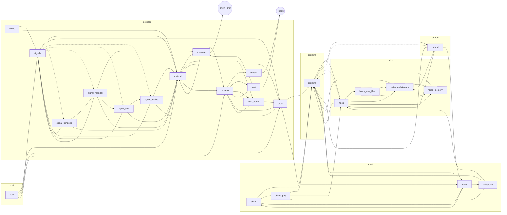

# Story: the topic graph

> Generated by `npm run model` from the code. Don't edit by hand.
> Solid arrows are chips; dotted arrows are links inside blocks (cards). Thick border: linked from the landing. Dashed: technical.

| Topic | File | Tags | Blocks | Words | Links to |
|---|---|---|---|---|---|
| `about` | about | overview, identity | text split text | 48 | projects, philosophy, ruben |
| `ahead` | services | overview | text text text | 41 | signals, method |
| `behold` | behold | project | text pills | 35 | haios, projects, ruben |
| `contact` | services | overview | text text stats text | 60 | _book |
| `cost` | services | overview | facts | 3 | estimate, _book, process |
| `estimate` | services | overview, tool | text estimate text | 128 | method, process, _show_brief |
| `haios` | haios | project, deep | text flow pills | 69 | haios_why_files, haios_architecture, haios_memory, projects |
| `haios_architecture` | haios | project, technical, deep | text code text | 47 | haios_memory, behold, projects |
| `haios_memory` | haios | project, technical, deep | text flow text | 58 | haios_architecture, projects |
| `haios_why_files` | haios | project, deep | text text callout | 67 | haios_architecture, haios_memory |
| `method` | services | overview | text compare | 86 | estimate, trust_ladder, proof, process |
| `philosophy` | about | identity | text flow text | 48 | projects, haios, salesforce |
| `process` | services | overview | text layers facts | 99 | contact, cost, trust_ladder |
| `projects` | projects | overview, work | text grid | 51 | haios, behold, behold, haios |
| `proof` | services | overview, work | fact flow | 29 | process, projects, ruben |
| `root` | root | entry | hero fact fact fact | 15 | method, signals, proof, process |
| `ruben` | about | identity, overview | text text pills badge callout fact | 67 | projects, salesforce, about |
| `salesforce` | about | identity, background | text text split text | 72 | haios, projects |
| `signal_blindside` | services | overview | callout text | 47 | signal_monday, method, signals |
| `signal_instinct` | services | overview | callout text | 51 | method, proof, signals |
| `signal_late` | services | overview | callout text | 36 | signal_instinct, method, signals |
| `signal_monday` | services | overview | callout text | 53 | estimate, signal_late, method, signals |
| `signals` | services | overview | text grid | 54 | method, proof, signal_blindside, signal_instinct, signal_late, signal_monday |
| `trust_ladder` | services | overview | flow text | 41 | proof, process |
