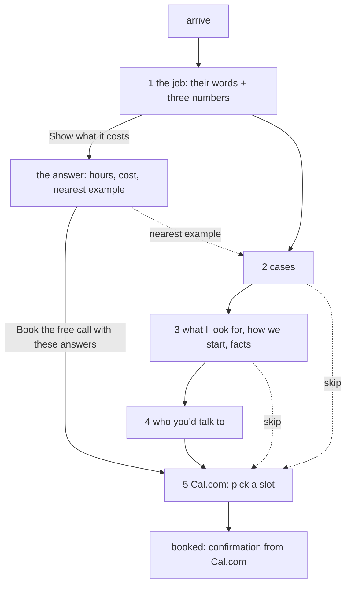

# Target: the funnel

> **Revised draft** (2026-10-15), replacing the version signed off on 2026-10-13. Hand-written. Compare with `../current/`.
> What changed and why: the end of this file. The reasoning: a panel of twelve reviews, summarised in the operator's workspace (`state/flow/inbox/2026-10-15-hive-priorities.md`).

One page, read top to bottom, ending at a booked call. It opens by asking the visitor about their own work and answers them.

```
  ┌───────────────────────────────────────────┐
  │ Tell me the job your team does by hand,   │  1 the job: the visitor puts
  │ every week.   [ the job ____________ ]    │    in their job and three
  │ people [2]  hours each [4]  salary [35k]  │    numbers; the page answers
  │            [ Show what it costs ]         │    with how much of their pay
  │  ↳ You: "the Monday report"               │    goes on the job, and the
  │    Of £70,000, £7,467 goes on this job ▦▦ │    nearest example below
  │    Nearest example: The Monday report     │
  ├───────────────────────────────────────────┤
  │ Where the time goes   (3 cases)           │  2 recognition: "that's us"
  ├───────────────────────────────────────────┤
  │ What I look for · How we'd start · facts  │  3 the diagnosis; lower the risk
  ├───────────────────────────────────────────┤
  │ Who you'd talk to   (Ruben, 4 lines)      │  4 trust; capacity said plainly
  ├───────────────────────────────────────────┤
  │ Book the free call    [Cal.com embed]     │  5 Cal.com slot, with the answers
  └───────────────────────────────────────────┘
```



Every step has a way straight to the booking. The job and the numbers help the call but are never required for it.

## The one conversational turn

The site was a conversation. Now it has exactly one turn, at the top, where the visitor's own words and numbers come back to them as something they could not get by reading. Everything else is a plain page you can scan.

- **The visitor gives:** the job (`job`, long text, optional) and three numbers: people doing it, hours each a week, salary of each person. The numbers start at 2, 4 and £35,000. (Changed 2026-10-15: start from the salary a director knows, not a cost per hour.)
- **The page answers** under the button, as one structured block:
  - their words, said back ("You: …"); if the field is empty, nothing is said back.
  - "Of the £70,000 a year you pay them, £7,467 goes on this job." Pay = people × salary; spent on this job = pay × hours ÷ 37.5. Then the full working weeks and the grid of weeks (people × hours × 46 ÷ 37.5).
  - the nearest of the three examples, by the words in the job, linked to it. If none is near, no line: the page does not pretend.
  - "Book the free call with these answers": opens step 5 with `job` = their words and, if they changed a number, `scale` = "2 people, 4 hours each a week, salary £35,000 each: about £7,467 a year on this job".
- **Nothing is sent.** The note under the button says so. Everything happens in the browser until the visitor books.
- **Without JavaScript:** the job field and a plain `scale` text field (people, how often), and a button that opens the Cal.com page with both filled in. No numbers, no answer.

This replaces both the old intake section (step 5) and the turn-by-turn conversation (cloud branch 6312ffa, 8898c9a): options worded as a menu were navigation dressed as a conversation.

## The diagnosis (step 3)

The examples are what a director recognises. What Ruben looks for is why it keeps happening. The same few problems are in every team, his own included:

- decisions rushed, because money due in and out was seen too late;
- work that does not earn money directly (admin, reports, records) left half-built, so it takes time from the work that does;
- the same job done two ways by two people;
- decisions nobody wrote down, so the same question gets settled again.

They are the first block of step 3, "What I look for", before "How we would start".

## Who you'd talk to (step 4)

- The day job is said plainly, with what it means for a client: a project becomes his full-time work. No hiding, no apology.
- His own system (Behold) is one line of proof, about the same problems, not a product: he built it and uses it every day. Nothing more is claimed. No product pages. Haios stays off the site.

## Keep / cut (from the signed-off version of 2026-10-13)

| Then | Now |
|---|---|
| 1 problem: headline about Ruben ("I find…") + cue line | 1 the job: a question about their work, answered. Cue line cut |
| 2 cases: Monday report, new client, supplier early warning + "Two more I often see" | Monday report, new client, **seeing the cash coming** (new). Supplier example and "Two more" cut |
| 3 how we would start + facts | "What I look for" first; "A one-page summary" becomes **"A one-page plan"**; Price says how it is agreed |
| 4 who you'd talk to | day job → capacity; one line on his own system |
| 5 intake | merged into 1 |
| 6 book | becomes 5; quiet links only after steps 2 and 3 |
| estimate: cut as too sales-y | back, as the answer to the visitor's own numbers |
| lens | still cut |

## Decided (2026-10-13), still true

**Cal.com is hosted, not installed.** Account `rwb3n`, event `30min` (30 minutes). Booking questions `job` (long text) and `scale` (short text), both optional, added 2026-10-15. `calLink` is `rwb3n/30min`.

**How the page reaches Cal.com.** Without JavaScript, a plain form (`method="get"`) to the Cal.com booking page, so the fields prefill it. With JavaScript, Cal.com's inline embed in step 5, with the answers in its `config`. Cal.com's script loads only when the visitor acts. Every "skip" link goes to `#book`.

**After booking:** Cal.com's own confirmation and email. No page of our own.

**Honesty.** The page never says "sent" or "received". "I reply the same day" is a fact about email, not about booking.

## Needs the operator

- Cal.com availability: the schedule is Monday–Friday, 09:00–17:00. Is that when you can take calls?
- Full name and a photograph for step 4 (`person.fullName` is empty).
- A price range, when you have one. Until then the page says how price is agreed.

## Changed (2026-10-15, evening): the site talks in UI components, live

> **Draft, awaiting the operator's sign-off.** Nothing here is built.
> Operator, 2026-10-15: "the whole concept was this website is supposed to
> showcase the new age of websites. AI generated, a performance." "Instead of
> talking in simply words, you talk in COMPONENTS… UI components." Chosen:
> **live AI** (a real model answers each visitor), over a scripted
> performance or the site-as-exhibit.

This reverses four decisions of 2026-10-13: *no Worker*, *no Turnstile*,
*nothing stored*, *no API key*. It is the site's first running cost.

### The idea

The visitor writes one sentence about their work. The site does not answer in
paragraphs. It answers in **UI components**, chosen and filled in for that
visitor by a model, and drawn by the site's own renderers, in front of them:

```
  You: two of us rebuild the sales report every Monday

  ▸ reading…                                         (status line, mono)
  ┌ stats ─────────────────────────────────────────┐
  │ The job   Weekly sales report, rebuilt by hand │
  │ Who       2 people   How often  Every Monday   │
  └────────────────────────────────────────────────┘
  ┌ compare: Today ⇄ Automated ────────────────────┐
  │ 3 systems → person → spreadsheet → report      │
  │ 3 systems → report → person checks             │  (steps move)
  └────────────────────────────────────────────────┘
  ┌ metricRow ─────────────────────────────────────┐
  │ £70,000 their pay │ £7,467 on this job │ 9.8 wk │  (our maths, not the model's)
  └────────────────────────────────────────────────┘
  ┌ layers: What I would automate first ───────────┐
  │ 1 Pull the three exports overnight              │
  │ 2 Build the report; flag what looks wrong       │
  │ 3 A person checks it before Monday 9am          │
  └────────────────────────────────────────────────┘
  Written by AI for this page, from your sentence. A first guess, not a diagnosis.
  [ Book the free call with this ]
```

Each component arrives as it is generated and animates in (the renderers
already have entrance motion). That is the performance: the page composes
itself for this visitor.

### The contract: components, never free text

- The model can only reply by calling one tool, `compose`, whose input is a
  list of blocks: `{ type, ...props }`. Allowed types: `stats`, `compare`,
  `flow`, `layers`, `timeline`, `table`, `pills`, `callout` (one line).
  Not `text` paragraphs. Not `estimate`, `fact`, `grid`, `badge`.
- The Worker validates every block against `src/catalog.js` (the same
  validator `npm test` uses) and the writing rules (`src/lint.js`). A block
  that fails is dropped. The page never shows unchecked model text.
- **Numbers are ours.** Money and time come from the visitor's own figures,
  computed in the browser (`src/job.js`), never from the model. The model
  may read "2 people, every Monday" out of the sentence to prefill the
  numbers; the visitor can change them.
- One sentence in, one composition out. No chat, no follow-up turns.

### What the model may and may not say (system prompt + checks)

- Only about the job the visitor described. Anything else: one honest
  `callout`, "I can only describe the work you put in the box."
- Never a price, a date, a promise of savings, a client name, or a claim
  that Ruben has done this exact job.
- Every composition ends with the label line (fixed, from `site.json`, not
  the model): "Written by AI for this page, from your sentence. A first
  guess, not a diagnosis."
- Plain words: the site's writing rules are in the prompt and checked after.

### Model, cost, speed

- Model: **Claude Opus 5.5** (`claude-opus-5-5`) by default, effort `low`,
  streaming, the catalogue and rules as a cached system prompt.
  Roughly: ~5,000 cached input tokens (about $0.001), ~1,500 output tokens
  (about $0.03). **About 3p a visitor who presses the button.**
- Cheaper, if he chooses: Sonnet 5.5 (about 1.5p) or Haiku 5.5 (about 0.1p).
  Faster too; the components are simple. Decided by trying all three on 20
  real sentences, not by guessing.
- A hard monthly ceiling (operator sets it, e.g. £20). Past it, the site
  falls back to step 1 as it is today, without saying anything is wrong.

### Infrastructure

- A Cloudflare Worker, `POST /compose`: holds the Anthropic API key (a
  Worker secret, never in the repo or the page), checks Turnstile, rate
  limits (5 a visitor a day, per IP), streams the blocks back.
- Nothing stored: no logs of sentences beyond Cloudflare's defaults, no
  database. (Beer's point stands: we will not know what people type. A
  count of compositions and bookings only, no content, is the most we keep.)
- Cloudflare is phase 5 anyway (hosting, Access, Web Analytics). The Worker
  can come first, on a `workers.dev` address, while the site stays on
  GitHub Pages.
- Without JavaScript, or if the Worker is down, slow (8 seconds) or over its
  ceiling: step 1 works exactly as it does now (numbers, answer, booking).

### Needs the operator

1. Sign off this section: the idea, the contract, the limits on what it says.
2. An Anthropic API key for the site (a separate key, with a spending limit).
3. A Cloudflare account (free plan) and a monthly ceiling in pounds.
4. Which model, after the 20-sentence trial.

### Order

1. Sign-off. 2. Twenty sample sentences (operator's words where possible) and
the system prompt, tried offline against the three models. 3. The Worker on
`workers.dev`. 4. The page: the streaming renderer and the label. 5. Local
UAT, then live.
