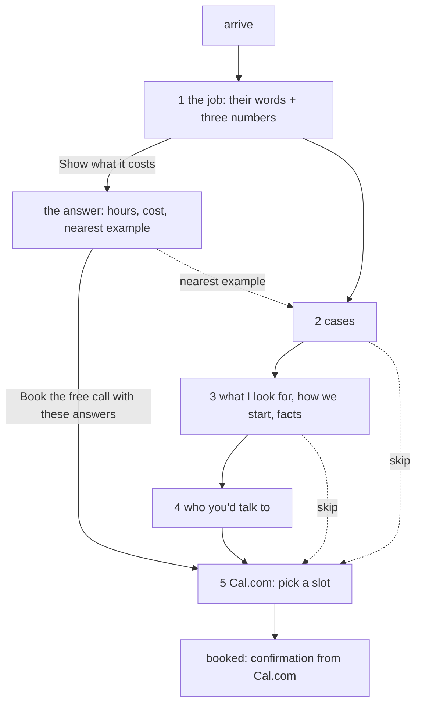

# Target: the funnel

> **Revised draft** (2026-10-15), replacing the version signed off on 2026-10-13. Hand-written. Compare with `../current/`.
> What changed and why: the end of this file. The reasoning: a panel of twelve reviews, summarised in the operator's workspace (`state/flow/inbox/2026-10-15-hive-priorities.md`).

One page, read top to bottom, ending at a booked call. It opens by asking the visitor about their own work and answers them.

```
  ┌───────────────────────────────────────────┐
  │ Tell me the job your team does by hand,   │  1 the job: the visitor puts
  │ every week.   [ the job ____________ ]    │    in their job and three
  │ people [2]  hours each [4]  salary [35k]  │    numbers; the page answers
  │            [ Show what it costs ]         │    with how much of their pay
  │  ↳ You: "the Monday report"               │    goes on the job, and the
  │    Of £70,000, £7,467 goes on this job ▦▦ │    nearest example below
  │    Nearest example: The Monday report     │
  ├───────────────────────────────────────────┤
  │ Where the time goes   (3 cases)           │  2 recognition: "that's us"
  ├───────────────────────────────────────────┤
  │ What I look for · How we'd start · facts  │  3 the diagnosis; lower the risk
  ├───────────────────────────────────────────┤
  │ Who you'd talk to   (Ruben, 4 lines)      │  4 trust; capacity said plainly
  ├───────────────────────────────────────────┤
  │ Book the free call    [Cal.com embed]     │  5 Cal.com slot, with the answers
  └───────────────────────────────────────────┘
```



Every step has a way straight to the booking. The job and the numbers help the call but are never required for it.

## The one conversational turn

The site was a conversation. Now it has exactly one turn, at the top, where the visitor's own words and numbers come back to them as something they could not get by reading. Everything else is a plain page you can scan.

- **The visitor gives:** the job (`job`, long text, optional) and three numbers: people doing it, hours each a week, salary of each person. The numbers start at 2, 4 and £35,000. (Changed 2026-10-15: start from the salary a director knows, not a cost per hour.)
- **The page answers** under the button, as one structured block:
  - their words, said back ("You: …"); if the field is empty, nothing is said back.
  - "Of the £70,000 a year you pay them, £7,467 goes on this job." Pay = people × salary; spent on this job = pay × hours ÷ 37.5. Then the full working weeks and the grid of weeks (people × hours × 46 ÷ 37.5).
  - the nearest of the three examples, by the words in the job, linked to it. If none is near, no line: the page does not pretend.
  - "Book the free call with these answers": opens step 5 with `job` = their words and, if they changed a number, `scale` = "2 people, 4 hours each a week, salary £35,000 each: about £7,467 a year on this job".
- **Nothing is sent.** The note under the button says so. Everything happens in the browser until the visitor books.
- **Without JavaScript:** the job field and a plain `scale` text field (people, how often), and a button that opens the Cal.com page with both filled in. No numbers, no answer.

This replaces both the old intake section (step 5) and the turn-by-turn conversation (cloud branch 6312ffa, 8898c9a): options worded as a menu were navigation dressed as a conversation.

## The diagnosis (step 3)

The examples are what a director recognises. What Ruben looks for is why it keeps happening. The same few problems are in every team, his own included:

- decisions rushed, because money due in and out was seen too late;
- work that does not earn money directly (admin, reports, records) left half-built, so it takes time from the work that does;
- the same job done two ways by two people;
- decisions nobody wrote down, so the same question gets settled again.

They are the first block of step 3, "What I look for", before "How we would start".

## Who you'd talk to (step 4)

- The day job is said plainly, with what it means for a client: a project becomes his full-time work. No hiding, no apology.
- His own system (Behold) is one line of proof, about the same problems, not a product: he built it and uses it every day. Nothing more is claimed. No product pages. Haios stays off the site.

## Keep / cut (from the signed-off version of 2026-10-13)

| Then | Now |
|---|---|
| 1 problem: headline about Ruben ("I find…") + cue line | 1 the job: a question about their work, answered. Cue line cut |
| 2 cases: Monday report, new client, supplier early warning + "Two more I often see" | Monday report, new client, **seeing the cash coming** (new). Supplier example and "Two more" cut |
| 3 how we would start + facts | "What I look for" first; "A one-page summary" becomes **"A one-page plan"**; Price says how it is agreed |
| 4 who you'd talk to | day job → capacity; one line on his own system |
| 5 intake | merged into 1 |
| 6 book | becomes 5; quiet links only after steps 2 and 3 |
| estimate: cut as too sales-y | back, as the answer to the visitor's own numbers |
| lens | still cut |

## Decided (2026-10-13), still true

**Cal.com is hosted, not installed.** Account `rwb3n`, event `30min` (30 minutes). Booking questions `job` (long text) and `scale` (short text), both optional, added 2026-10-15. `calLink` is `rwb3n/30min`.

**How the page reaches Cal.com.** Without JavaScript, a plain form (`method="get"`) to the Cal.com booking page, so the fields prefill it. With JavaScript, Cal.com's inline embed in step 5, with the answers in its `config`. Cal.com's script loads only when the visitor acts. Every "skip" link goes to `#book`.

**After booking:** Cal.com's own confirmation and email. No page of our own.

**Honesty.** The page never says "sent" or "received". "I reply the same day" is a fact about email, not about booking.

## Needs the operator

- Cal.com availability: the schedule is Monday–Friday, 09:00–17:00. Is that when you can take calls?
- Full name and a photograph for step 4 (`person.fullName` is empty).
- A price range, when you have one. Until then the page says how price is agreed.

## Changed (2026-10-15, evening): the site talks in UI components, chosen by a decision model

> **Draft, awaiting the operator's sign-off.** Nothing here is built.
> Operator, 2026-10-15: "the whole concept was this website is supposed to
> showcase the new age of websites. AI generated, a performance." "Instead of
> talking in simply words, you talk in COMPONENTS… UI components." "We would
> use the new class of models emerging: decision models" (Jev, TypeSafe, on
> OpenRouter). Chosen over a scripted performance and over the site as the
> exhibit.

This reverses four decisions of 2026-10-13: *no Worker*, *no Turnstile*,
*nothing stored*, *no API key*. It is the site's first running cost (close
to nothing; see below).

### The idea

The visitor writes one sentence about their work. The site does not answer in
paragraphs. It answers in **UI components**. A decision model reads the
sentence and **decides**: which job it is, which systems it touches, how
often, how many people, whether it is repeated work at all. Each decision
picks or fills a component the site already has. The page assembles itself
for this visitor, in front of them, one component at a time.

```
  You: two of us rebuild the sales report every Monday

  ▸ deciding…                                 (status line, mono; ~0.2 s)
  ┌ stats ─────────────────────────────────────────┐
  │ The job    A report, rebuilt by hand   (0.94)  │  Choice: job type
  │ Systems    Accounts · Spreadsheet · Email      │  Noul per system
  │ How often  Every week                          │  Score: frequency
  └────────────────────────────────────────────────┘
  ┌ compare: Today ⇄ Automated ────────────────────┐  template for "report",
  │ Accounts → person → spreadsheet → email        │  slots filled with the
  │ Accounts → report → person checks → email      │  systems it found
  └────────────────────────────────────────────────┘
  ┌ metricRow ─────────────────────────────────────┐
  │ £70,000 their pay │ £7,467 on this job │ 9.8 wk │  our maths, their numbers
  └────────────────────────────────────────────────┘
  ┌ layers: What I would automate first ───────────┐  written by Ruben for
  │ 1 …   2 …   3 …                                │  "report", not by a model
  └────────────────────────────────────────────────┘
  Chosen by a decision model from your sentence. The words are mine.
  [ Book the free call with this ]
```

**When it is unsure, it asks back, in a component.** Below a confidence
threshold, the page shows the top two or three choices as buttons ("Which is
closer?") instead of guessing. That is still a component, not a sentence.

### Why a decision model, not a writing model

- **Honest by construction.** Jev returns typed answers with probabilities,
  never text. Every word on the page is written by Ruben in advance and
  passes the writing rules. Nothing to check after the fact, nothing to
  hallucinate.
- **Fast:** about 0.2 seconds (P50 0.18 s, P99 0.48 s, OpenRouter, 2026-10-15).
- **Cheap:** $0.042 per million input tokens, output free. A visitor's request
  is about 2,000 tokens: **about a hundredth of a penny each.**
- It is the point of the site: a working example of the kind of system Ruben
  builds (software that decides, and a person who checks).

### The questions (one request per visitor)

All in one call to `POST https://openrouter.ai/api/alpha/decisions`, model
`typesafe/jev-1.14`, with the sentence as `state`:

| Question | Primitive | Options | Drives |
|---|---|---|---|
| Is this a job someone does by hand, again and again? | Noul | yes / no | everything else; if no, one honest component back |
| Which kind of job is it? | Choice | report · new client or customer · invoices and payments · copying between systems · scheduling and bookings · approvals · chasing people · other | which template |
| Does it involve {system}? (one per system) | Noul | spreadsheet · email · accounts · CRM · bank · paper · website or portal · phone | the steps in `compare` / `flow` |
| How often? | Score | daily · weekly · monthly · quarterly | prefills "hours each, per week" |
| How many people? | Choice | one · two or three · four to ten · more | prefills "people doing it" |

Prefilled numbers are marked as guesses and stay editable; `scale` goes into
the booking only if the visitor confirms or changes them.

### The templates (written by Ruben, in `content/`)

One set per job type: a `compare` (today / automated) with slots for the
systems, a `layers` "What I would automate first", and the nearest example
case. Eight job types × three components, all linted like the rest of the
site. Adding a job type is content, not code.

### Infrastructure

- A Cloudflare Worker, `POST /decide`: holds the OpenRouter key (a Worker
  secret), checks Turnstile, rate limits (20 a visitor a day), forwards the
  sentence and the fixed questions, returns the typed answers. The page
  does the rest.
- Nothing stored by us. The sentence goes to OpenRouter and TypeSafe; their
  data policy is to be checked before launch and named in the privacy note.
- A hard monthly ceiling on the OpenRouter key (e.g. $5). Past it, or if the
  Worker is down or slow (2 seconds), or without JavaScript: step 1 works as
  it does now.
- Cloudflare is phase 5 anyway. The Worker can come first, on `workers.dev`,
  while the site stays on GitHub Pages.

### Later, if wanted

A writing model (Claude) could add one line of words for an unusual job.
Not in the first version: the decision model and Ruben's words come first.

### Needs the operator

1. Sign off this section.
2. An OpenRouter API key for the site, with a spending limit.
3. A Cloudflare account (free plan).
4. The words for the templates: I draft them, he edits.

### Order

1. Sign-off. 2. Twenty real sentences, tried against Jev offline: are the
decisions right, and where should the thresholds sit? 3. Templates for the
eight job types. 4. The Worker. 5. The page: components arriving in order,
the ask-back, the label. 6. Local UAT, then live.
