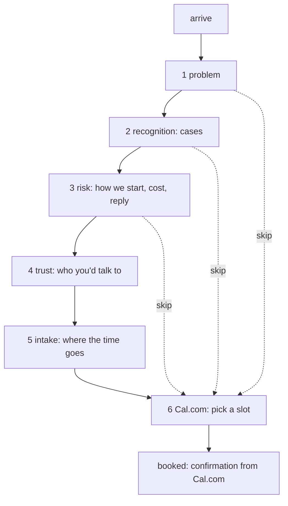
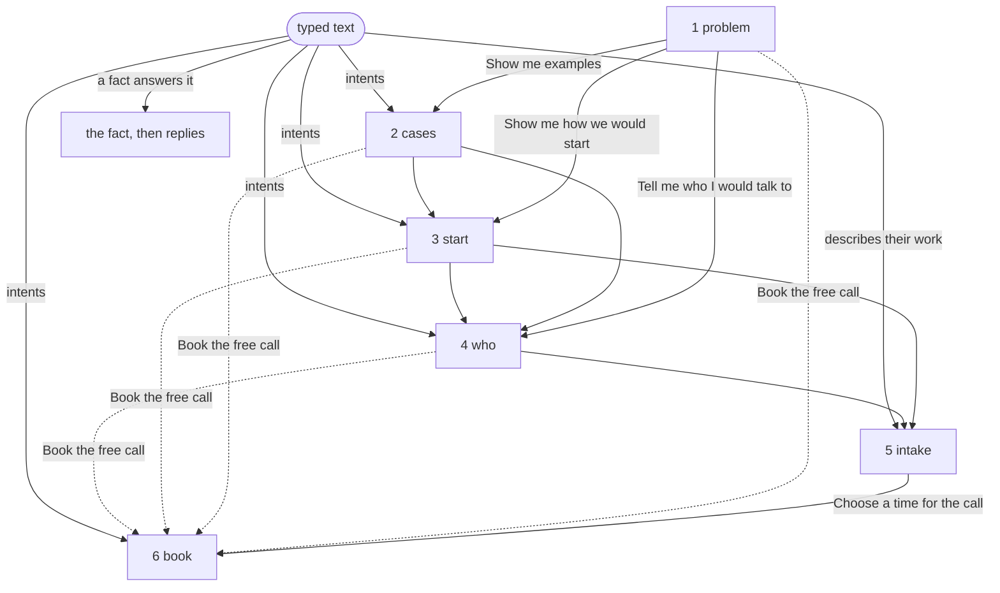

# Target: the funnel

> **Signed off** (operator, 2026-10-13). Hand-written. Compare with `../current/`.

One page, read top to bottom, ending at a booked call.

```
  ┌───────────────────────────────────────────┐
  │ I find the work your team repeats…        │  1 problem
  ├───────────────────────────────────────────┤
  │ Where the time goes   (3 cases)           │  2 recognition: "that's us"
  ├───────────────────────────────────────────┤
  │ How we'd start · cost · reply time        │  3 lower the risk
  ├───────────────────────────────────────────┤
  │ Who you'd talk to   (Ruben, 3 lines)      │  4 trust
  ├───────────────────────────────────────────┤
  │ Tell me where the time goes: [_________]  │  5 intake
  │              [ Book the free call ]       │  6 Cal.com slot
  └───────────────────────────────────────────┘
```



Every step has a way straight to the booking. Intake helps the call but is never required for it.

## Keep / cut (from `../current/story.md`)

| Today | Becomes |
|---|---|
| landing path: cases, how, book | steps 2, 3, 6 |
| landing path: proof (Callsheet) | cut: Callsheet is not running (claims removed live in PR #22) |
| method, cost, process, trust_ladder | folded into step 3 as short answers |
| signals + 4 signal_* | folded into step 2 (the cases) |
| estimate | cut for now: reads as too sales-y, needs work |
| about, ruben, philosophy, salesforce | one block, step 4 |
| projects, callsheet, haios, behold + 13 technical | cut |
| conversation L1 / L2, gravity | cut |
| conversation L3 + brief | becomes step 5, intake |
| one page `/#/all` | becomes the whole site |
| lens | cut for now |

## Decided (2026-10-13)

The operator signed off phase 1 and asked for these to be decided.

**Cal.com is hosted, not installed.** The site is static, so Cal.com cannot run on it. The hosted free plan covers what the funnel needs: an event type, booking questions, prefill and the embed.

**Intake is one set of questions, in two places.** The fields on the page are Cal.com booking questions. Each field's name is the question's identifier in Cal.com, so the answers are carried into the booking and arrive in the booking email.

- Two fields, both optional: *Which job takes up your team's time?* (`job`, long text) and *How many people do it, and how often?* (`scale`, short text).
- Cal.com asks for name and email itself. The page does not.
- Booking questions, not `metadata[...]`: metadata is stored but not shown on the booking.
- No intake Worker, no Turnstile, no storage of our own. Answers exist only inside a booking.

**How the page reaches Cal.com.**

- Without JavaScript: the intake is a plain form (`method="get"`) whose action is the Cal.com booking page, so the fields prefill it there.
- With JavaScript: the same form opens Cal.com's inline embed in step 6, with the answers in its `config`.
- Cal.com's script loads only when the visitor acts (opens the booking step or sends the form), never on page load.
- Every "skip" link goes to step 6 (`#book`).

**After booking:** Cal.com's own confirmation, inside the embed, and Cal.com's confirmation email. No redirect and no success page of our own. What happens after the call is already said in step 3.

**Honesty.** The page never says "sent" or "received". If the visitor fills in the fields and leaves, nothing was sent, and nothing on the page suggests it was. "I reply the same day" stays a fact about email, not about booking.

## Changed (2026-10-15): the funnel is a conversation

> **Draft.** The operator chose this shape on 2026-10-15 ("think about the
> original idea before converting the user journey to be more
> conventional"). The order, the honesty rules and Cal.com are unchanged;
> how the visitor moves through it changes.

The original site was a conversation: the visitor chose replies or typed, and
the site answered with topics. The funnel above keeps its order and its end,
but is delivered the same way.

- **Each step is a turn.** The page opens on step 1. Its end offers replies:
  the next steps, in the visitor's voice, and "Book the free call". Choosing
  one says it back ("You: Show me examples") and opens that step under it.
  Only the latest turn offers replies, and never to a step already open.
- **Typed text** (`src/route.js`), in this order: a description of the
  visitor's own work opens the intake with their words in its first field (it
  replaces the old L3 brief); a question a fact answers gets that fact (old
  L2, now from `site.json › facts` only, so it never says more than the page);
  words in a step's intents open it (old L1); anything else gets one honest
  line. No gravity, no fake thinking delays, no stored session.
- **Without JavaScript, nothing changes:** every step in order, as above.
  "Show the whole page" (and `/#all`) gives the same view with JavaScript.
- **Composable.** Steps are `site.json › page.sections`; each is a list of
  parts (`src/parts.js`, shown on `/components/`). Reordering, removing,
  adding or repeating steps and parts needs no code. `npm run sync` refuses a
  page that does not validate.

Rows of the keep/cut table this changes: *conversation L1 / L2, gravity* →
L1 and L2 return as typed text, gravity stays cut. *One page `/#/all`
becomes the whole site* → it is the site without JavaScript, and one click
away with it.



**Needs the operator:** a Cal.com account with a 30-minute event type and the two questions (`job`, `scale`). Phase 3 and U4 cannot be tested without it.
