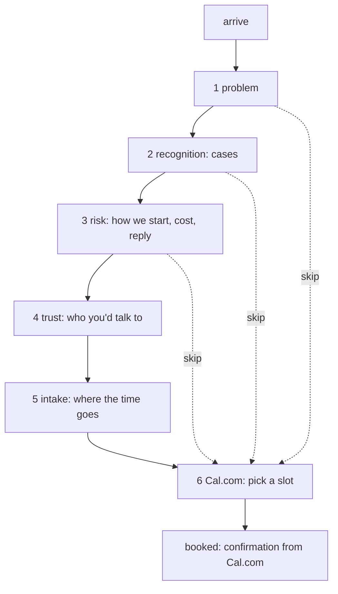

# Target: the funnel

> **Draft** (2026-10-11). Hand-written. Compare with `../current/`.

One page, read top to bottom, ending at a booked call.

```
  ┌───────────────────────────────────────────┐
  │ I find the work your team repeats…        │  1 problem
  ├───────────────────────────────────────────┤
  │ Where the time goes   (3 cases)           │  2 recognition: "that's us"
  ├───────────────────────────────────────────┤
  │ How we'd start · cost · reply time        │  3 lower the risk
  ├───────────────────────────────────────────┤
  │ Who you'd talk to   (Ruben, 3 lines)      │  4 trust
  ├───────────────────────────────────────────┤
  │ Tell me where the time goes: [_________]  │  5 intake
  │              [ Book the free call ]       │  6 Cal.com slot
  └───────────────────────────────────────────┘
```



Every step has a way straight to the booking. Intake helps the call but is never required for it.

## Keep / cut (from `../current/story.md`)

| Today | Becomes |
|---|---|
| landing path: cases, how, book | steps 2, 3, 6 |
| landing path: proof (Callsheet) | **open**: is it still running? If not, it goes |
| method, cost, process, trust_ladder | folded into step 3 as short answers |
| signals + 4 signal_* | folded into step 2 (the cases) |
| estimate | **open**: keep as an aside in step 3, or cut |
| about, ruben, philosophy, salesforce | one block, step 4 |
| projects, callsheet, haios, behold + 13 technical | cut |
| conversation L1 / L2, gravity | cut |
| conversation L3 + brief | becomes step 5, intake |
| one page `/#/all` | becomes the whole site |
| lens | **open**: keep only if it earns attention for the headline |

## Open

- Does intake come before the booking, inside Cal.com's own questions, or both?
- What does the visitor see after booking?
