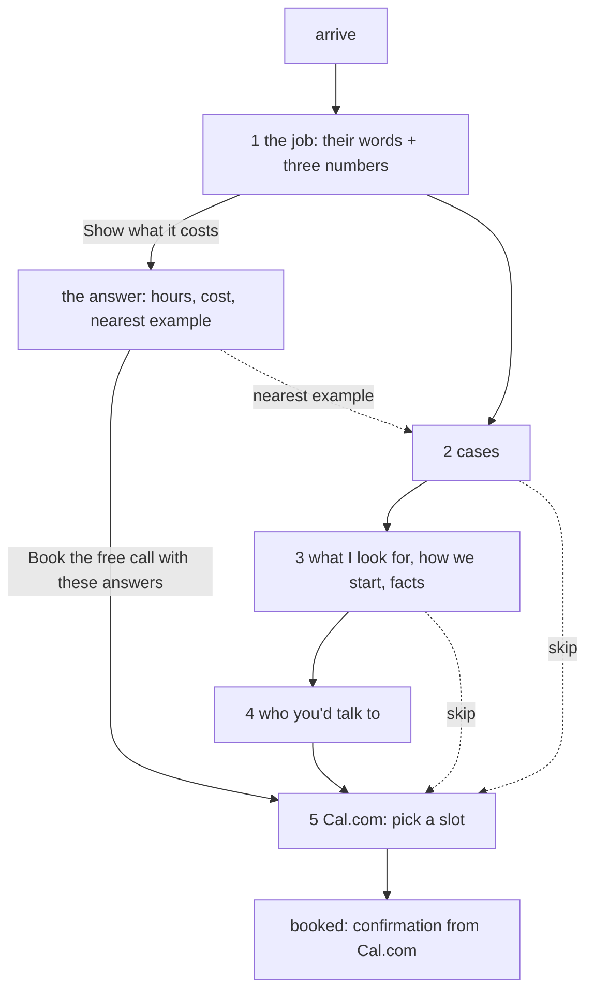

# Target: the funnel

> **Revised draft** (2026-10-15), replacing the version signed off on 2026-10-13. Hand-written. Compare with `../current/`.
> What changed and why: the end of this file. The reasoning: a panel of twelve reviews, summarised in the operator's workspace (`state/flow/inbox/2026-10-15-hive-priorities.md`).

One page, read top to bottom, ending at a booked call. It opens by asking the visitor about their own work and answers them.

```
  ┌───────────────────────────────────────────┐
  │ Which job does your team do by hand,      │  1 the job: the visitor puts
  │ every week?   [ the job ____________ ]    │    in their job and three
  │ people [3]  hours each [4]  £/hour [30]   │    numbers; the page answers
  │            [ Show what it costs ]         │    with hours a year, cost a
  │  ↳ You: "the Monday report"               │    year, and the nearest
  │    552 hours a year · £16,560 · ▦▦▦▦▦     │    example below
  │    Nearest example: The Monday report     │
  ├───────────────────────────────────────────┤
  │ Where the time goes   (3 cases)           │  2 recognition: "that's us"
  ├───────────────────────────────────────────┤
  │ What I look for · How we'd start · facts  │  3 the diagnosis; lower the risk
  ├───────────────────────────────────────────┤
  │ Who you'd talk to   (Ruben, 4 lines)      │  4 trust; capacity said plainly
  ├───────────────────────────────────────────┤
  │ Book the free call    [Cal.com embed]     │  5 Cal.com slot, with the answers
  └───────────────────────────────────────────┘
```



Every step has a way straight to the booking. The job and the numbers help the call but are never required for it.

## The one conversational turn

The site was a conversation. Now it has exactly one turn, at the top, where the visitor's own words and numbers come back to them as something they could not get by reading. Everything else is a plain page you can scan.

- **The visitor gives:** the job (`job`, long text, optional) and three numbers: people doing it, hours each a week, cost per hour (salary plus other staff costs). The numbers start at 3, 4 and £30.
- **The page answers** under the button, as one structured block:
  - their words, said back ("You: …"); if the field is empty, nothing is said back.
  - hours a year and cost a year, with the grid of working weeks (the `estimate` showpiece), computed in the browser: hours a year = people × hours × 46 weeks; cost a year = hours a year × cost per hour.
  - the nearest of the three examples, by the words in the job, linked to it. If none is near, no line: the page does not pretend.
  - "Book the free call with these answers": opens step 5 with `job` = their words and `scale` = "3 people, 4 hours each a week, about 552 hours a year".
- **Nothing is sent.** The note under the button says so. Everything happens in the browser until the visitor books.
- **Without JavaScript:** the job field and a plain `scale` text field (people, how often), and a button that opens the Cal.com page with both filled in. No numbers, no answer.

This replaces both the old intake section (step 5) and the turn-by-turn conversation (cloud branch 6312ffa, 8898c9a): options worded as a menu were navigation dressed as a conversation.

## The diagnosis (step 3)

The examples are what a director recognises. What Ruben looks for is why it keeps happening. The same few problems are in every team, his own included:

- decisions rushed, because money due in and out was seen too late;
- work that does not earn money directly (admin, reports, records) left half-built, so it takes time from the work that does;
- the same job done two ways by two people;
- decisions nobody wrote down, so the same question gets settled again.

They are the first block of step 3, "What I look for", before "How we would start".

## Who you'd talk to (step 4)

- The day job is said plainly, with what it means for a client: a project becomes his full-time work. No hiding, no apology.
- His own system (Behold) is one line of proof, about the same problems, not a product: he keeps a record of every decision, and uses it every day. No product pages. Haios stays off the site.

## Keep / cut (from the signed-off version of 2026-10-13)

| Then | Now |
|---|---|
| 1 problem: headline about Ruben ("I find…") + cue line | 1 the job: a question about their work, answered. Cue line cut |
| 2 cases: Monday report, new client, supplier early warning + "Two more I often see" | Monday report, new client, **seeing the cash coming** (new). Supplier example and "Two more" cut |
| 3 how we would start + facts | "What I look for" first; "A one-page summary" becomes **"A one-page plan"**; Price says how it is agreed |
| 4 who you'd talk to | day job → capacity; one line on his own system |
| 5 intake | merged into 1 |
| 6 book | becomes 5; quiet links only after steps 2 and 3 |
| estimate: cut as too sales-y | back, as the answer to the visitor's own numbers |
| lens | still cut |

## Decided (2026-10-13), still true

**Cal.com is hosted, not installed.** Account `rwb3n`, event `30min` (30 minutes). Booking questions `job` (long text) and `scale` (short text), both optional, added 2026-10-15. `calLink` is `rwb3n/30min`.

**How the page reaches Cal.com.** Without JavaScript, a plain form (`method="get"`) to the Cal.com booking page, so the fields prefill it. With JavaScript, Cal.com's inline embed in step 5, with the answers in its `config`. Cal.com's script loads only when the visitor acts. Every "skip" link goes to `#book`.

**After booking:** Cal.com's own confirmation and email. No page of our own.

**Honesty.** The page never says "sent" or "received". "I reply the same day" is a fact about email, not about booking.

## Needs the operator

- Cal.com availability: the schedule is Monday–Friday, 09:00–17:00. Is that when you can take calls?
- Full name and a photograph for step 4 (`person.fullName` is empty).
- A price range, when you have one. Until then the page says how price is agreed.
